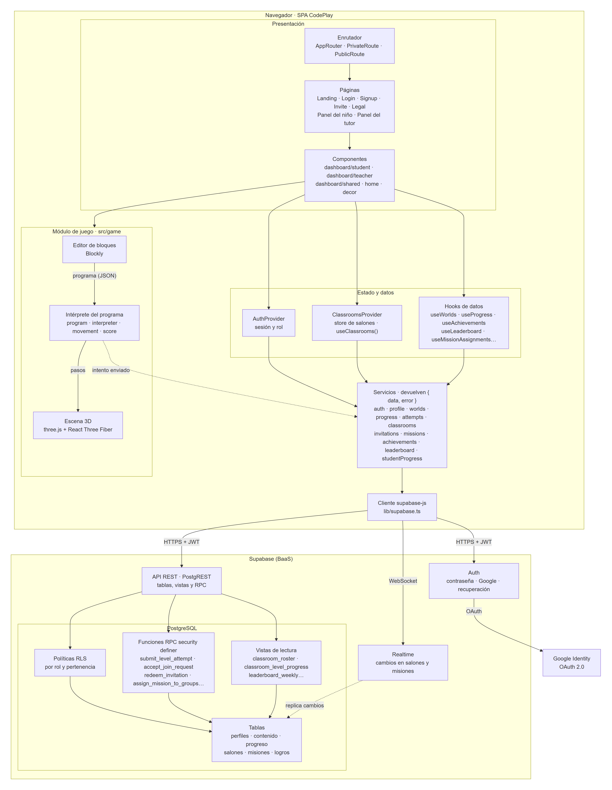
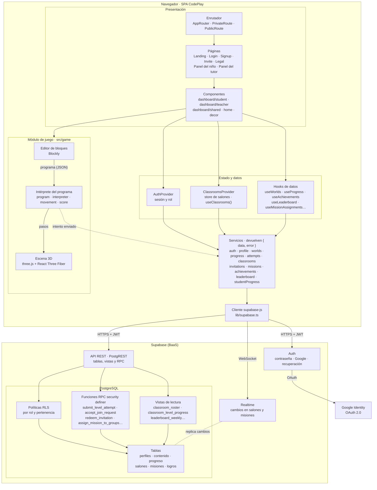
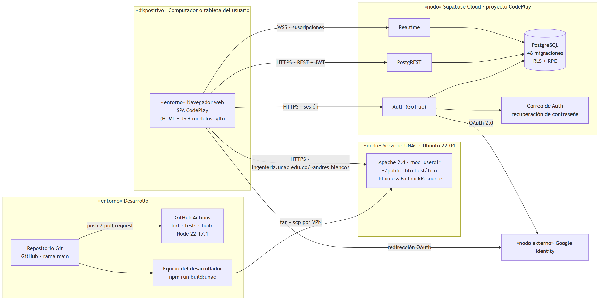
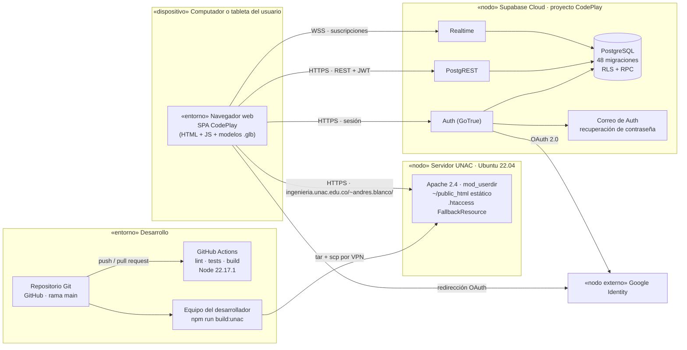
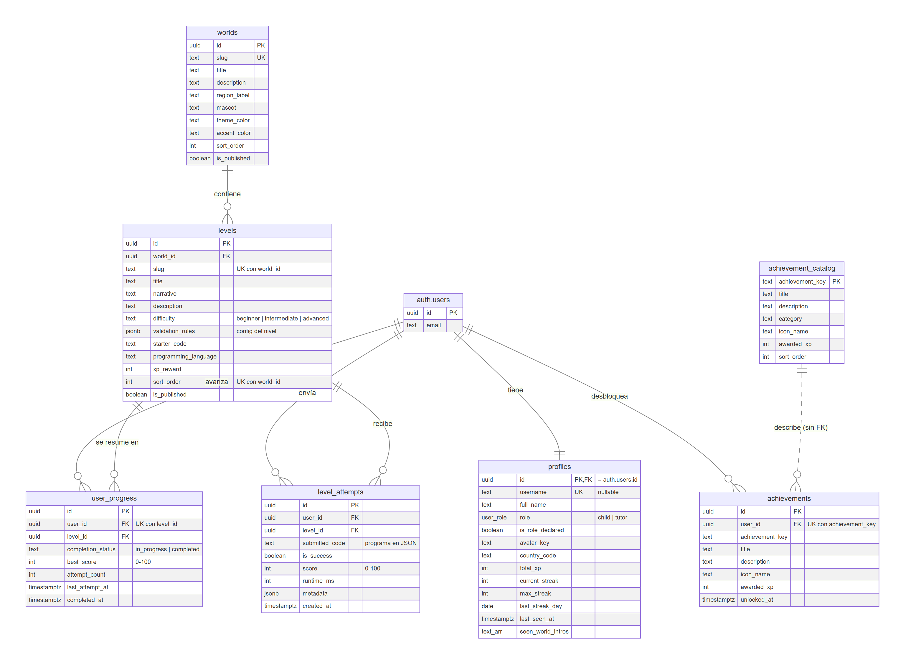
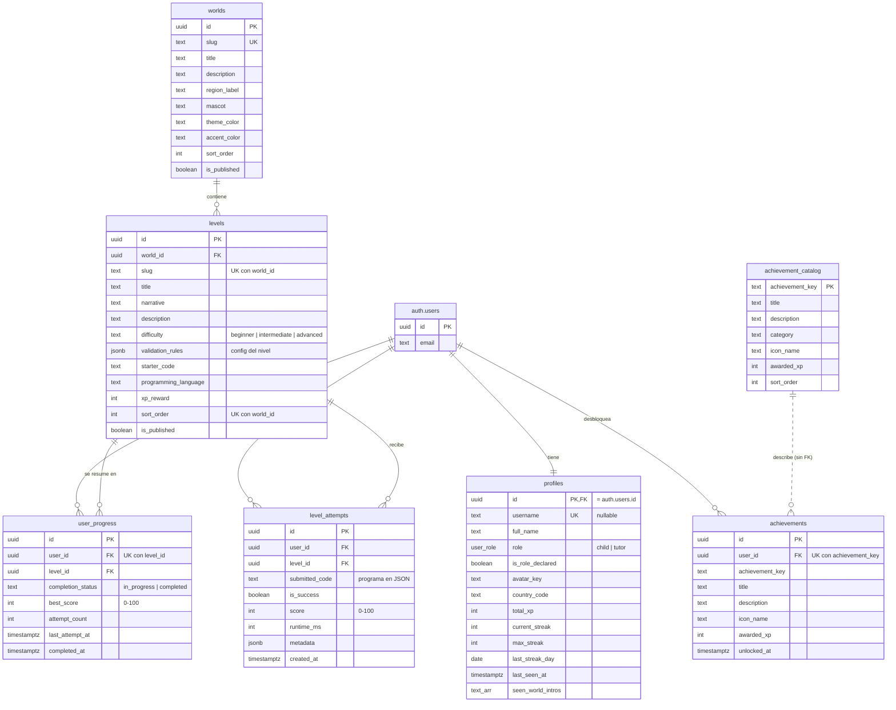
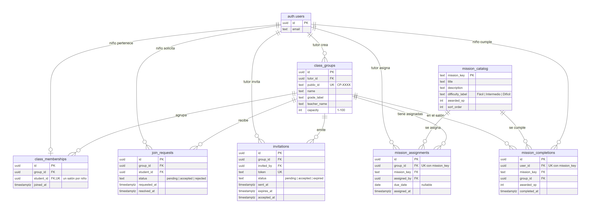
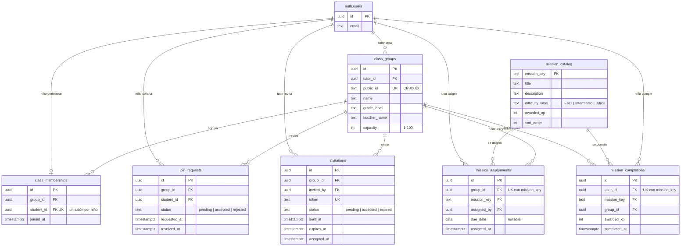

# CodePlay — Arquitectura y modelo de datos

> Diagramas del **objetivo 2** del proyecto de grado: arquitectura de
> componentes, arquitectura de despliegue y modelo entidad–relación.
> Hechos contra el código y el esquema a 27-oct-2026: las tablas y columnas
> salen de `apps/web/src/types/database.types.ts`, que se genera de la base
> real, y las claves foráneas de `supabase/migrations/`.
>
> Las fuentes son los bloques Mermaid de este archivo (GitHub los dibuja); las
> imágenes para el documento escrito están en [`diagramas/`](diagramas/).

---

## 1. Diagrama de componentes

**Cómo se lee.** La aplicación es una SPA (React 18, TypeScript y Vite) que corre entera en el navegador y
no tiene servidor propio: todo lo que persiste lo hace Supabase. Tres reglas de
la arquitectura se ven en el diagrama:

- **Una sola salida al backend.** Las vistas no llaman a Supabase: pasan por los
  proveedores y los hooks, que usan los servicios, que usan el único cliente.
  Los salones tienen además su frontera propia, `ClassroomsProvider`.
- **El servidor decide lo que vale puntos.** El juego ejecuta el programa en el
  navegador para animarlo, pero la puntuación, el XP, las rachas, los logros y
  las misiones los calcula `submit_level_attempt` en la base, a partir del
  programa enviado. El cliente no puede escribirse el progreso.
- **La seguridad está en la base.** Cada tabla tiene RLS; lo que una política no
  puede expresar sin ciclos o sin dar de más va en funciones `security definer`.

## 2. Diagrama de despliegue

**Estado.** Es el despliegue **definitivo** desde el 28-oct-2026 (`ROADMAP.md`
§27.2): la app vive en `https://ingenieria.unac.edu.co/~andres.blanco/`, servida
por el Apache de la universidad desde la carpeta del usuario. La subida es
manual porque el usuario no tiene `sudo` y el servidor sólo se alcanza con la
VPN. El provisional de la prueba preliminar del 25-sep-2026 sigue en Vercel
(`https://codeplay-pgrado-web.vercel.app`) y no se dibuja.

El navegador habla **directamente** con Supabase: Apache sólo sirve archivos.
La clave anónima viaja en el bundle por diseño; lo que protege los datos es el
JWT de la sesión y las políticas RLS de la base.

## 3. Modelo entidad–relación

El modelo se parte en dos diagramas para que quepa en una página; los une
`auth.users`, que aparece en ambos.

### 3.1 Usuarios, contenido y progreso

### 3.2 Salones y misiones

**Notas sobre el modelo.**

- **Todas las claves de usuario apuntan a `auth.users`**, la tabla de cuentas de
  Supabase, y no a `profiles`. `profiles` comparte la misma clave (relación
  1:1) y la crea un disparador al registrarse. Borrar la cuenta borra en cascada
  todo lo demás.
- **El rol** (`child`/`tutor`) vive en `profiles.role`. Las relaciones marcadas
  «tutor» o «niño» las restringen las políticas RLS, no la clave foránea.
- **Un niño está como mucho en un salón**: `unique (student_id)` en
  `class_memberships`. Las solicitudes se acumulan (sin unicidad), pero sólo
  puede haber una `pending` por niño, con un índice único parcial.
- **`user_progress` resume y `level_attempts` registra**: un intento por envío,
  y una fila de progreso por niño y nivel con la mejor puntuación.
- **`achievements` copia el título y la descripción del logro** en el momento de
  concederlo, y se une al catálogo por `achievement_key` sin clave foránea.
- **`levels.validation_rules`** guarda la configuración completa del nivel
  (cuadrícula, inicio, meta, bloques, máximo de pasos) en un solo `jsonb`, con
  el formato fijado en `CONTRATO-DE-INTEGRACION.md` §4.
- **Vistas** (no aparecen como entidades porque no guardan datos):
  `class_group_directory`, `classroom_roster`, `classroom_level_progress`,
  `classroom_level_attempts`, `classroom_student_activity` y
  `leaderboard_weekly`.
